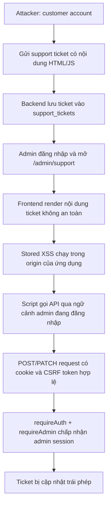

# Attack Chain 2 — Stored XSS → Admin Session Riding → Unauthorized Admin Action

> **Phạm vi:** Tài liệu thiết kế và hướng dẫn demo trong môi trường đồ án/lab local do nhóm sở hữu. Không triển khai trên hệ thống thật hoặc dữ liệu người dùng thật.
>
> **Trạng thái source tại thời điểm khảo sát:** Module Support Ticket hiện đang render nội dung ticket bằng `textContent`, có xác thực admin và CSRF protection. Vì vậy, chain dưới đây là kịch bản cần tạo có kiểm soát để phục vụ kiểm thử bảo mật; không phải khẳng định rằng source hiện tại đang có Stored XSS.

---

## 1. Tổng quan Attack Chain 2

### 1.1. Tên và mục tiêu

**Stored XSS → Admin Session Riding → Unauthorized Admin Action**

Mục tiêu là chứng minh một tài khoản customer thông thường có thể gửi nội dung ticket chứa mã HTML/JavaScript; nếu giao diện quản trị render nội dung đó không an toàn, JavaScript sẽ chạy trong origin của ứng dụng khi admin mở ticket. Script sau đó lợi dụng ngữ cảnh trình duyệt đã đăng nhập của admin để gọi một API quản trị hợp lệ.

Hành động cuối được chọn cho đồ án là **tự ý cập nhật trạng thái và/hoặc nội dung phản hồi của ticket** thông qua API quản trị Support hiện có. Đây là hành động phù hợp với source thực tế, không cần bịa thêm API thay đổi role, tạo admin hay export dữ liệu.

### 1.2. Sơ đồ luồng



### 1.3. Vai trò của từng thành phần

| Thành phần | Vai trò trong chain |
|---|---|
| Customer Support form | Điểm attacker đưa dữ liệu vào ứng dụng |
| `supportController.create` | Lưu subject/message vào database |
| Database `support_tickets` | Lưu payload để tồn tại sau request (đặc trưng Stored XSS) |
| Admin Support page | Nơi admin xem dữ liệu do customer gửi |
| `support.js` | Đọc dữ liệu API và tạo DOM ticket; đây là điểm cần kiểm tra output handling |
| `MocApi.request` trong `api.js` | Hàm gọi API cùng origin, tự lấy CSRF token cho request thay đổi trạng thái |
| `requireAuth` + `requireAdmin` | Backend xác minh request thuộc admin đang đăng nhập |
| `supportController.updateAdmin` | Hành động đặc quyền cuối: cập nhật trạng thái/phản hồi ticket |

### 1.4. Vì sao đây là một attack chain thực sự?

Mỗi mắt xích giải quyết một rào cản khác nhau:

1. **Stored XSS** đưa JavaScript của attacker vào origin hợp lệ của ứng dụng.
2. **Admin Session Riding** khiến request phát sinh trong browser context của admin, thay vì session của attacker.
3. **Unauthorized Admin Action** chứng minh script không chỉ hiển thị popup mà đã thực hiện được một thao tác chỉ admin mới có quyền.

Nếu chỉ có popup `alert()`, ta mới chứng minh được JavaScript execution. Muốn chứng minh chain hoàn chỉnh, phải quan sát được API quản trị được gọi và dữ liệu ticket thay đổi.

### 1.5. Hành động cuối nên chọn

Chọn một ticket thử nghiệm riêng, ví dụ `HT-xxxxx`, và thực hiện một trong hai thao tác:

- Đổi trạng thái ticket từ `open` sang `in_progress` hoặc `resolved`.
- Ghi một phản hồi đánh dấu thử nghiệm vào ticket.

Không nên chọn hành động thay đổi role hoặc tạo tài khoản admin vì source được cung cấp không có endpoint đó trong module Support. Cũng không nên gọi đây là “chiếm toàn bộ server” hay “chiếm admin lâu dài”: bằng chứng hiện tại chỉ chứng minh hành động trái phép trong quyền của admin trên module Support.

---

## 2. Các file cần sửa, lý do và ảnh hưởng

### 2.1. Tóm tắt thay đổi

| File | Thay đổi đề xuất | Mục đích |
|---|---|---|
| `frontend/public/js/support.js` | Tạo biến thể demo render ticket content bằng `innerHTML` thay vì `textContent` tại các vị trí dữ liệu không tin cậy | Tạo điểm Stored XSS có kiểm soát |
| `backend/src/controllers/supportController.js` | Không cần sửa để tạo chain; endpoint create hiện lưu nội dung ticket và endpoint admin update đã tồn tại | Giữ nguyên luồng backend thật, tránh thay đổi không cần thiết |
| `backend/src/routes/supportRoutes.js` | Không sửa; route admin đã có `requireAuth` và `requireAdmin` | Chứng minh API đích là API đặc quyền thật |
| `frontend/public/js/api.js` | Không sửa; `MocApi.request()` đã tự lấy CSRF token cho POST/PUT/PATCH/DELETE | Cho thấy XSS cùng origin có thể sử dụng cơ chế request hợp lệ của ứng dụng |
| `frontend/views/support/tickets.ejs` | Không cần sửa; form customer đã có sẵn | Điểm nhập dữ liệu đã tồn tại |
| `frontend/views/admin/support.ejs` | Không cần sửa; trang admin đã có sẵn vùng danh sách ticket | Điểm kích hoạt payload đã tồn tại |

### 2.2. File chính: `frontend/public/js/support.js`

**Vai trò hiện tại**

Hàm `element(tag, className, text)` tạo DOM node và gán nội dung bằng:

```js
node.textContent = String(text);
```

Các trường ticket như subject, message và admin reply được đưa vào DOM qua helper này. Đây là cách xử lý an toàn đối với HTML-like input: chuỗi `` được hiển thị như văn bản, không được trình duyệt diễn giải thành phần tử HTML.

**Thay đổi trong bản demo có lỗ hổng**

Tạo một biến thể demo có chủ đích không an toàn: tại vị trí render trường dữ liệu do customer kiểm soát, diễn giải chuỗi như HTML thay vì text. Phạm vi tối thiểu nên giới hạn ở:

- `ticket.subject`
- `ticket.message`
- `ticket.admin_reply` nếu muốn kiểm thử cả nội dung phản hồi

Không cần thay đổi toàn bộ helper nếu điều đó làm nhiều vùng UI khác bị ảnh hưởng. Nên ghi chú rõ trong code đây là **insecure demo variant**, không phải bản sửa bảo mật.

**Lý do**

Stored XSS xảy ra khi dữ liệu attacker gửi được lưu lại và sau đó được đưa vào HTML context mà không được encode/sanitize đúng cách. Chỉ lưu chuỗi HTML vào database chưa tự tạo ra XSS; lỗ hổng phát sinh ở bước render phía browser.

**Ảnh hưởng trong chain**

- Customer gửi payload một lần.
- Payload được lưu trong database.
- Admin tải danh sách ticket.
- Trình duyệt admin diễn giải payload thành HTML và kích hoạt JavaScript.
- JavaScript chạy trong origin của ứng dụng, có quyền tương tác với DOM và các API mà origin đó cho phép.

**Khôi phục an toàn**

Sau demo, khôi phục cách render bằng `textContent` hoặc dùng sanitizer được cấu hình đúng nếu sản phẩm thực sự cần hỗ trợ rich text. Không dùng `innerHTML` trực tiếp với nội dung customer.

#### Chi tiết từng dòng cần sửa

**Vị trí 1 — Dòng 48 (Render tiêu đề `ticket.subject`):**

- code gốc:

```js
summary.append(top, element('span', 'support-ticket-subject', ticket.subject));
```

- Thay thế bằng: 

```js
// INSECURE DEMO VARIANT: Render ticket.subject bằng innerHTML
const subjectNode = element('span', 'support-ticket-subject');
subjectNode.innerHTML = String(ticket.subject ?? '');
summary.append(top, subjectNode);
```
- **Giải thích:** Khi truyền `ticket.subject` vào tham số thứ 3 của `element(...)`, hàm `element` sẽ gán bằng `textContent` (dòng 22). Khi tách ra tạo thẻ `<span>` rỗng trước rồi gán `subjectNode.innerHTML = String(ticket.subject ?? '')`, payload HTML/JS nằm trong tiêu đề ticket sẽ thực thi ngay khi danh sách ticket vừa được tải (thậm chí trước cả khi Admin bấm mở thẻ `<details>`).

**Vị trí 2 — Dòng 53 gốc (Render nội dung `ticket.message` — Điểm kích hoạt chính):**

- Code gốc: 

```js
body.append(element('p', 'support-ticket-body', ticket.message));
```

- Thay thế bằng: 

```js
// INSECURE DEMO VARIANT: Render ticket.message bằng innerHTML
const messageNode = element('p', 'support-ticket-body');
messageNode.innerHTML = String(ticket.message ?? '');
body.append(messageNode);
```

- **Giải thích:** Trường `message` cho phép nhập tối đa 4.000 ký tự (so với 150 ký tự của `subject`), nên đây là nơi chứa payload chính của Attacker để gọi `window.MocApi.request(...)` thực hiện Admin Session Riding. Khi chuyển sang `.innerHTML`, trình duyệt của Admin sẽ phân tích cú pháp chuỗi HTML (như ``) và chạy mã JavaScript trong cùng origin của trang quản trị.

**Vị trí 3 (Tùy chọn) — Dòng 55 gốc và Dòng 106 gốc (Render `ticket.admin_reply`):**

- code gốc:

  - Dòng 55:
  
    ```js
    const replyText = element('p', 'support-ticket-reply-text',      ticket.admin_reply);
    ```

  - Dòng 106:

    ```js
    replyText.textContent = updated.admin_reply || '';
    ```

- Thay thế bằng:

   ```js
  // Thay dòng 55 gốc:
  const replyText = element('p', 'support-ticket-reply-text');
  if (ticket.admin_reply !== undefined && ticket.admin_reply !== null) {
    replyText.innerHTML = String(ticket.admin_reply);
  }
  
  // Thay dòng 106 gốc:
  replyText.innerHTML = updated.admin_reply || '';
  ```
- **Giải thích:** Giúp kiểm thử trường hợp nội dung phản hồi (`admin_reply`) cũng bị render không an toàn khi tải trang (dòng 55) hoặc ngay sau khi nhấn nút lưu phản hồi (dòng 106).

### 2.3. File backend: `backend/src/controllers/supportController.js`

**Không cần sửa để tạo chain.**

Các điểm đáng chú ý trong source:

- `create` kiểm tra kiểu dữ liệu, độ dài subject/message và lưu bằng parameterized query.
- `listAdmin` trả ticket cùng customer name/email cho giao diện admin.
- `updateAdmin` chỉ chấp nhận các field `status` và `reply`.
- `updateAdmin` kiểm tra status thuộc `open`, `in_progress`, `resolved`; reply có giới hạn độ dài.

Backend lưu nội dung ticket như dữ liệu. Đây là hành vi bình thường; trách nhiệm encode theo output context nằm ở nơi dữ liệu được render.

**Ảnh hưởng trong chain**

Controller cung cấp dữ liệu đã lưu cho trang admin và cung cấp API đích cho hành động cuối. Việc không sửa controller giúp chứng minh vấn đề nằm ở output handling phía frontend, không phải SQL injection hay lỗi phân quyền backend.

### 2.4. File route: `backend/src/routes/supportRoutes.js`

**Không sửa.**

Các route hiện có:

- `POST /api/support/tickets`
- `GET /api/support/tickets`
- `GET /api/support/tickets/:id`
- `GET /api/support/admin/tickets`
- `PATCH /api/support/admin/tickets/:id`

Toàn bộ router áp dụng `requireAuth`; hai route admin tiếp tục áp dụng `requireAdmin`.

**Ảnh hưởng trong chain**

Request cuối vẫn phải đi qua kiểm tra đăng nhập và quyền admin. Chain không bypass trực tiếp `requireAdmin`; nó lợi dụng việc JavaScript đã chạy bên trong browser session của admin. Đây là điểm phân biệt giữa lỗi authorization backend và XSS dẫn đến session riding.

### 2.5. File API client: `frontend/public/js/api.js`

**Không sửa.**

`MocApi.request()` có hai hành vi quan trọng:

- Dùng `credentials: 'include'` để browser gửi cookie phù hợp với request cùng origin.
- Với các method thay đổi dữ liệu (`POST`, `PUT`, `PATCH`, `DELETE`), hàm gọi `/auth/csrf` để lấy token và gắn `X-CSRF-Token`.

**Ảnh hưởng trong chain**

Nếu XSS chạy cùng origin, script có thể gọi API client hiện có. Vì API client tự thực hiện quy trình CSRF, payload không cần tự hardcode token. Điều này minh họa một nguyên tắc quan trọng: CSRF token giúp chống request giả mạo từ origin bên ngoài, nhưng không phải biện pháp ngăn XSS chạy trong origin đáng tin cậy.

Không được xóa CSRF middleware hoặc tắt kiểm tra CSRF để làm demo dễ hơn. Làm vậy sẽ thay đổi bản chất kịch bản.

### 2.6. Các file giao diện

**`frontend/views/support/tickets.ejs`**

Form customer có field subject và message, giới hạn độ dài ở giao diện. Đây là điểm nhập dữ liệu. Không cần thêm form mới.

**`frontend/views/admin/support.ejs`**

Trang admin có `data-support-admin`, danh sách ticket `data-support-list` và nút refresh. Đây là trang admin cần mở để kích hoạt Stored XSS.

**Ảnh hưởng trong chain**

Tận dụng UI sẵn có giúp demo gần với quy trình nghiệp vụ thật: customer gửi yêu cầu hỗ trợ, nhân viên/admin mở hộp thư hỗ trợ để xử lý.

### 2.7. Những file không nên sửa

- `backend/src/middlewares/authMiddleware.js`: không bỏ `requireAdmin`.
- `backend/src/middlewares/csrfMiddleware.js`: không tắt CSRF.
- `backend/src/app.js`: không cần thêm route giả.
- Database schema/migration: không cần thêm cột hoặc bảng để minh họa chain này.

Giữ các lớp bảo vệ backend nguyên vẹn giúp chứng minh đúng tác động của Stored XSS.

---

## 3. Hướng dẫn demo Attack Chain

### 3.1. Chuẩn bị môi trường

Chỉ chạy trên bản local/staging cô lập của nhóm:

1. Sao lưu source hiện tại hoặc tạo Git branch riêng cho demo.
2. Khởi động ứng dụng theo README của dự án.
3. Đảm bảo database là database thử nghiệm, không chứa ticket khách hàng thật.
4. Chuẩn bị hai tài khoản:
   - `customer_demo`: tài khoản thường để gửi ticket.
   - `admin_demo`: tài khoản admin để mở trang quản trị.
5. Mở Burp Suite hoặc DevTools Network để quan sát request.
6. Ghi lại trạng thái ban đầu của ticket thử nghiệm.

Không sử dụng tài khoản admin thật, dữ liệu khách hàng thật hoặc triển khai bản có lỗ hổng lên Internet.

### 3.2. Bước 1 — Xác nhận baseline an toàn

Trước khi bật biến thể demo:

1. Đăng nhập bằng customer demo.
2. Mở `/support`.
3. Gửi một ticket có nội dung HTML-like vô hại, ví dụ:

```html

```

4. Mở ticket vừa tạo ở phía customer.
5. Xác nhận nội dung được hiển thị như văn bản, không xuất hiện hộp thoại.
6. Đăng nhập admin demo và mở `/admin/support`.
7. Xác nhận nội dung cũng hiển thị như văn bản.

**Kết quả mong đợi:** Không có JavaScript execution. Đây là baseline chứng minh source gốc đang xử lý output an toàn.

### 3.3. Bước 2 — Bật biến thể demo Stored XSS

Trong branch demo, thay đổi riêng cách render subject/message trong `frontend/public/js/support.js` theo mô tả tại mục 2.2.

Sau đó:

1. Restart/reload frontend nếu quy trình build yêu cầu.
2. Xóa ticket thử nghiệm cũ hoặc tạo ticket mới để tránh nhầm kết quả.
3. Đăng nhập customer demo.
4. Gửi lại nội dung kiểm thử ở bước 3.2.

Payload trên chỉ nhằm chứng minh JavaScript execution bằng một hộp thoại vô hại. Không sử dụng payload đọc cookie, gửi dữ liệu ra ngoài hoặc đánh cắp thông tin đăng nhập.

### 3.4. Bước 3 — Kích hoạt Stored XSS bằng tài khoản admin

1. Mở một browser session riêng cho admin demo.
2. Đăng nhập bằng admin demo.
3. Truy cập `/admin/support`.
4. Tìm ticket do customer demo vừa tạo.
5. Mở ticket hoặc refresh danh sách nếu cần.
6. Quan sát hộp thoại `alert(document.domain)`.

**Bằng chứng cần ghi lại:**

- Ticket được tạo từ customer.
- Nội dung payload tồn tại trong ticket sau khi tải lại trang.
- Hộp thoại xuất hiện khi admin mở ticket.
- Domain trong hộp thoại là origin của ứng dụng local.

Điều này chứng minh payload không chạy ở trang của attacker mà chạy trong trang ứng dụng khi admin xem dữ liệu đã lưu.

### 3.5. Bước 4 — Chứng minh Admin Session Riding

Sau khi đã xác nhận JavaScript chạy trong trang admin, kiểm thử một hành động đặc quyền có phạm vi nhỏ trên ticket demo.

Luồng logic cần chứng minh:

1. JavaScript đang chạy trong trang `/admin/support`.
2. Script gọi API quản trị cập nhật ticket thử nghiệm thông qua API client cùng origin.
3. Browser gửi cookie của phiên admin.
4. API client lấy và gửi CSRF token theo cơ chế hiện có.
5. Backend xác thực user và role admin.
6. Endpoint cập nhật trạng thái/phản hồi ticket trả về thành công.

API đích hiện có:

```http
PATCH /api/support/admin/tickets/{ticketId}
Content-Type: application/json
X-CSRF-Token: <token do API client lấy>
Cookie: <admin session cookie>
```

Body thử nghiệm:

```json
{
  "status": "in_progress",
  "reply": "DEMO: cập nhật được thực hiện trong bài kiểm thử Stored XSS."
}
```

Trong demo, chỉ dùng ticket do nhóm tạo. Có thể thực hiện thao tác thông qua `MocApi.request()` hiện có trong browser context; không cần lấy hoặc in giá trị cookie ra màn hình.

**Lưu ý kỹ thuật:** Nếu chỉ dùng `fetch()` thủ công mà không gửi CSRF token, request có thể bị từ chối. Đó không phải bằng chứng XSS không hoạt động. Hãy kiểm tra Network và phân biệt lỗi thiếu CSRF token với lỗi xác thực/quyền. Không tắt CSRF để vượt qua lỗi này.

### 3.6. Bước 5 — Xác minh kết quả cuối

Sau khi request thành công:

1. Quan sát response của `PATCH /api/support/admin/tickets/{ticketId}` trong Network/Burp.
2. Kiểm tra status HTTP thành công.
3. Refresh trang admin và xác nhận trạng thái/phản hồi đã thay đổi.
4. Đăng nhập customer demo hoặc mở ticket phía customer để xác nhận thay đổi được hiển thị.
5. Lưu ảnh chụp trước và sau khi thay đổi.

**Tiêu chí thành công của toàn chain:**

| Mốc | Bằng chứng |
|---|---|
| Input | Customer gửi ticket chứa nội dung kiểm thử |
| Persistence | Nội dung vẫn còn sau khi reload/tải lại từ API |
| Trigger | Admin mở ticket và JavaScript chạy |
| Session riding | Request phát sinh từ browser context admin |
| Authorization | Backend chấp nhận request với quyền admin |
| Impact | Ticket demo bị cập nhật ngoài thao tác chủ động của admin |

Không kết luận chain thành công chỉ dựa vào alert. Phải có bằng chứng hành động quản trị cuối cùng.

### 3.7. Ghi nhận bằng Burp Suite

Nên lưu tối thiểu các request/response sau:

1. `POST /api/support/tickets` — customer tạo ticket.
2. `GET /api/support/admin/tickets` — admin tải danh sách.
3. `PATCH /api/support/admin/tickets/{id}` — request cập nhật trái phép phát sinh sau khi XSS chạy.

Khi đưa vào báo cáo, che token, cookie, email và thông tin cá nhân. Chỉ giữ lại các trường cần thiết để chứng minh luồng tấn công.

### 3.8. Demo đối chứng sau khi khắc phục

Sau khi hoàn thành demo:

1. Khôi phục `textContent` hoặc cơ chế output encoding an toàn.
2. Giữ nguyên ticket thử nghiệm.
3. Mở lại trang admin.
4. Xác nhận chuỗi HTML/JavaScript chỉ hiển thị dưới dạng văn bản.
5. Xác nhận không có alert.
6. Xác nhận không có request PATCH ngoài ý muốn.
7. Chạy lại test hỗ trợ hiện có, đặc biệt `backend/test/support-mysql.cjs` và browser smoke test nếu môi trường hỗ trợ.

Đối chứng này giúp báo cáo thể hiện rõ trước/sau khi khắc phục.

---

## 4. Cơ sở lý thuyết

### 4.1. Stored XSS là gì?

Cross-Site Scripting (XSS) là lỗi cho phép nội dung không đáng tin cậy được trình duyệt diễn giải thành mã thực thi. Với Stored XSS, dữ liệu chứa payload được lưu lại (ví dụ database) và được thực thi khi một người dùng khác xem nội dung đó.

Khác với Reflected XSS, payload không nhất thiết phải nằm trong URL hoặc request mà nạn nhân vừa bấm. Nó có thể tồn tại trong ticket, bình luận, đánh giá sản phẩm hoặc hồ sơ người dùng.

### 4.2. Phân biệt `textContent` và `innerHTML`

- `textContent`: gán nội dung như văn bản thuần; các ký tự HTML không được diễn giải thành DOM element.
- `innerHTML`: diễn giải chuỗi như HTML; nếu chuỗi chứa dữ liệu không tin cậy và không được xử lý đúng, có thể tạo XSS.

Đây là điểm kỹ thuật trọng tâm của demo. Việc dùng `innerHTML` không phải lúc nào cũng tự động là lỗ hổng; rủi ro xuất hiện khi dữ liệu không tin cậy được đưa vào HTML context mà không có biện pháp bảo vệ phù hợp.

### 4.3. Vì sao payload của customer chạy trong trình duyệt admin?

Trình duyệt áp dụng same-origin policy. Khi admin mở trang ứng dụng, nội dung ticket được render trong origin của ứng dụng. Nếu payload được diễn giải thành JavaScript, script chạy với origin đó.

Do vậy, script có thể tương tác với các tài nguyên cùng origin mà browser context được phép truy cập, bao gồm gọi API của ứng dụng. Nó không cần biến thành một phiên đăng nhập độc lập của attacker.

### 4.4. Admin Session Riding là gì?

Đây là cách mô tả việc script chạy trong browser session của admin và lợi dụng phiên đó để thực hiện hành động. Nó không đồng nghĩa với việc attacker biết mật khẩu hoặc lấy được cookie.

Trong chain này:

- Attacker kiểm soát nội dung ticket.
- Admin là người mở trang chứa ticket.
- Browser giữ phiên đăng nhập admin.
- Script phát sinh request trong chính browser context đó.

Tên gọi “session riding” nhấn mạnh việc lợi dụng phiên đã xác thực, không phải đánh cắp thông tin xác thực.

### 4.5. Cookie HttpOnly có ngăn được Stored XSS không?

Không. `HttpOnly` ngăn JavaScript đọc trực tiếp cookie thông qua các API như `document.cookie`. Tuy nhiên, nó không ngăn JavaScript chạy trong origin gửi request cùng origin; browser vẫn có thể tự đính kèm cookie phù hợp.

Vì vậy, không nên kết luận rằng cookie `HttpOnly` loại bỏ nguy cơ XSS. Nó giảm một số hậu quả, đặc biệt là đánh cắp cookie trực tiếp, nhưng không ngăn session riding.

### 4.6. CSRF và XSS khác nhau thế nào?

| Tiêu chí | CSRF | XSS |
|---|---|---|
| Bản chất | Lợi dụng browser gửi request đã xác thực ngoài ý muốn | Thực thi script trong origin của ứng dụng |
| Script chạy trong origin ứng dụng? | Không nhất thiết | Có |
| Có thể đọc DOM/token cùng origin? | Thông thường không | Có thể, tùy chính sách và vị trí dữ liệu |
| CSRF token | Là biện pháp phòng vệ quan trọng | Không đủ để ngăn XSS |
| Trong chain này | Không phải lỗ hổng gốc | Là lỗ hổng gốc |

CSRF token hiện có vẫn cần được giữ. Tuy nhiên, khi JavaScript đã chạy trong origin hợp lệ, nó có thể sử dụng các chức năng cùng origin để lấy token và gửi request. Vì thế, XSS có thể vượt qua mục tiêu bảo vệ mà CSRF token hướng đến.

### 4.7. Vì sao không phải Authentication Bypass hoặc IDOR?

- Không có việc bỏ qua đăng nhập: admin đã đăng nhập hợp lệ.
- Không có việc thay đổi `userId` để đọc dữ liệu người khác: chain không dựa trên IDOR.
- Không có việc backend bỏ qua `requireAdmin`: backend vẫn xác minh quyền admin.
- Lỗ hổng nằm ở việc dữ liệu không tin cậy được thực thi trong browser context của người có quyền cao.

Đây là lý do chain 2 khác rõ rệt với chain 1:

| Attack Chain 1 | Attack Chain 2 |
|---|---|
| SQL Injection → Authentication Bypass → IDOR/BOLA | Stored XSS → Admin Session Riding → Unauthorized Admin Action |
| Trọng tâm backend/database | Trọng tâm browser/frontend |
| Lợi dụng xác thực và kiểm soát object | Lợi dụng ngữ cảnh phiên admin |
| Kết quả: lộ dữ liệu nhiều người dùng | Kết quả: thao tác trái phép bằng quyền admin |

### 4.8. Root cause và biện pháp khắc phục

**Root cause chính**

Dữ liệu do người dùng kiểm soát được đưa vào HTML context mà không được output encode hoặc sanitize phù hợp.

**Biện pháp khắc phục**

1. Ưu tiên `textContent`, `createTextNode` và DOM API an toàn khi chỉ cần hiển thị văn bản.
2. Nếu cần rich text, dùng HTML sanitizer uy tín với allowlist cấu hình chặt chẽ; không tự viết bộ lọc bằng regex.
3. Áp dụng Content Security Policy (CSP) phù hợp như một lớp phòng thủ bổ sung; không coi CSP là thay thế cho output encoding.
4. Giữ cookie session có `HttpOnly`, `Secure` trong HTTPS và `SameSite` phù hợp.
5. Tiếp tục duy trì CSRF protection cho các thao tác thay đổi trạng thái.
6. Giới hạn quyền admin theo nguyên tắc least privilege.
7. Với hành động quản trị có rủi ro cao, cân nhắc xác nhận bổ sung và ghi audit log.

### 4.9. Security impact và giới hạn kết luận

**Tác động chứng minh được trong đồ án:**

- JavaScript do customer kiểm soát chạy trong origin ứng dụng khi admin xem ticket.
- Script có thể sử dụng browser context của admin để gọi API được cấp quyền.
- Một thao tác quản trị Support có thể được thực hiện ngoài ý muốn của admin.

**Không nên khẳng định nếu chưa có bằng chứng:**

- Đánh cắp được mật khẩu hoặc cookie.
- Chiếm quyền hệ điều hành/server.
- Tạo được tài khoản admin mới.
- Duy trì quyền admin sau khi admin đăng xuất.
- Đọc được mọi dữ liệu trong database.

Phạm vi impact phải tương ứng với endpoint và dữ liệu thực sự chứng minh trong demo.

---

## 5. Kịch bản trình bày trước giảng viên

Có thể trình bày trong khoảng 5–7 phút:

1. **Giới thiệu (30 giây):** Chain 1 tập trung vào backend; chain 2 tập trung vào browser và phiên quản trị.
2. **Cho xem Support workflow (45 giây):** Customer gửi ticket, admin nhận ticket.
3. **Baseline (45 giây):** Với source an toàn, chuỗi HTML được hiển thị như văn bản.
4. **Bật demo variant (30 giây):** Giải thích thay đổi output handling trong `support.js`.
5. **Kích hoạt (60 giây):** Admin mở ticket, alert xuất hiện trong origin ứng dụng.
6. **Chứng minh impact (90 giây):** Quan sát request PATCH và trạng thái/phản hồi ticket thay đổi.
7. **Khắc phục (60 giây):** Khôi phục `textContent`, chạy lại và chứng minh payload không thực thi.

Thông điệp kết luận nên là:

> Stored XSS không chỉ gây ảnh hưởng đến người gửi dữ liệu. Khi người có quyền cao xem nội dung độc hại, mã JavaScript có thể chạy trong browser context của họ và lợi dụng phiên đã xác thực để thực hiện hành động trái phép. Cookie HttpOnly và CSRF token không thay thế được việc xử lý output an toàn.

---

## 6. Checklist triển khai

### Trước demo

- [ ] Có branch hoặc bản sao source dành riêng cho demo.
- [ ] Database chỉ chứa dữ liệu thử nghiệm.
- [ ] Có customer demo và admin demo.
- [ ] Đã ghi nhận baseline an toàn.
- [ ] Đã xác định ticket ID dùng để demo.
- [ ] Burp Suite/DevTools Network sẵn sàng.

### Trong demo

- [ ] Customer gửi ticket.
- [ ] Ticket được lưu và vẫn tồn tại sau reload.
- [ ] Admin mở ticket.
- [ ] XSS được kích hoạt trong origin ứng dụng.
- [ ] Có request đến API admin.
- [ ] Backend chấp nhận request với admin session.
- [ ] Ticket demo thay đổi như mong đợi.

### Sau demo

- [ ] Khôi phục output handling an toàn.
- [ ] Xác nhận payload chỉ hiển thị dạng text.
- [ ] Xác nhận không còn JavaScript execution.
- [ ] Chạy lại test liên quan.
- [ ] Không để bản demo có lỗ hổng trong nhánh triển khai.
- [ ] Che cookie, CSRF token và thông tin cá nhân khỏi ảnh chụp báo cáo.

---

## 7. Kết luận và phạm vi triển khai được đề xuất

Nên chốt Attack Chain 2 theo hướng:

**Stored XSS trong Support Ticket → Admin Session Riding → Unauthorized Support Ticket Modification**

Đây là lựa chọn phù hợp với source hiện tại vì module Support đã có đầy đủ luồng customer tạo ticket, admin xem ticket và API admin cập nhật ticket. Chỉ cần tạo một biến thể render không an toàn trong frontend để mô phỏng điểm yếu; không cần xây dựng thêm API giả hoặc phá bỏ authentication/authorization/CSRF đang có.

Chain này bổ sung tốt cho Attack Chain 1:

- Chain 1 chứng minh cách kết hợp lỗi backend để vượt authentication và object authorization.
- Chain 2 chứng minh cách một lỗi frontend có thể làm suy yếu ranh giới tin cậy giữa customer và admin, dù backend vẫn có cơ chế xác thực và phân quyền.

**Khuyến nghị:** Giữ nguyên source gốc làm baseline, tạo branch demo riêng, lưu request/response và ảnh chụp trước/sau. Trong báo cáo cần ghi rõ đâu là trạng thái source ban đầu, đâu là thay đổi cố ý để tái hiện lỗ hổng, và đâu là bản đã khắc phục.
